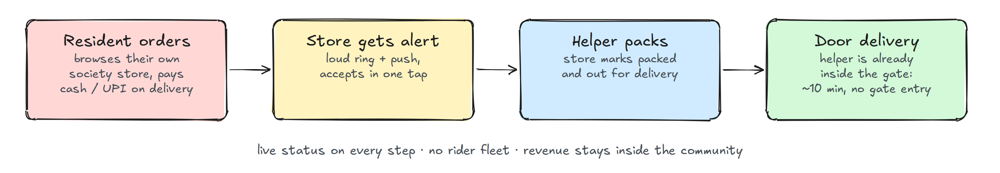
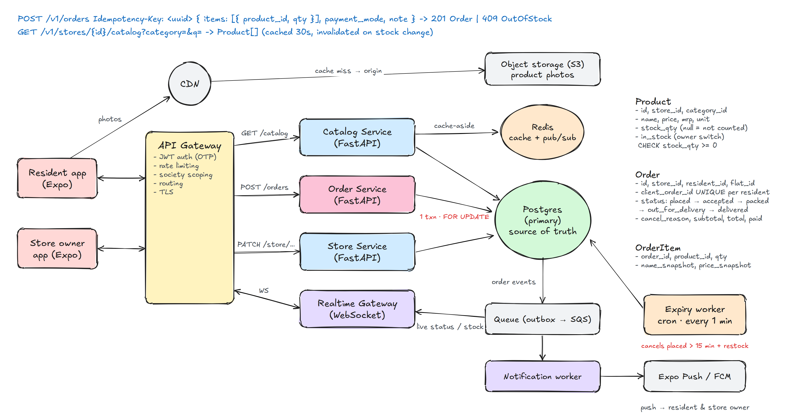
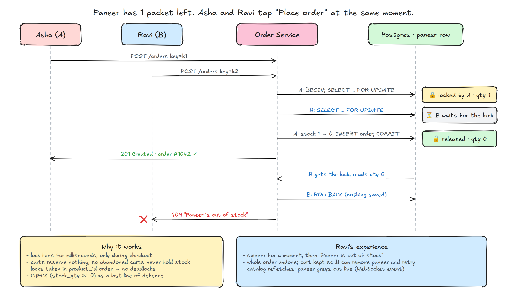
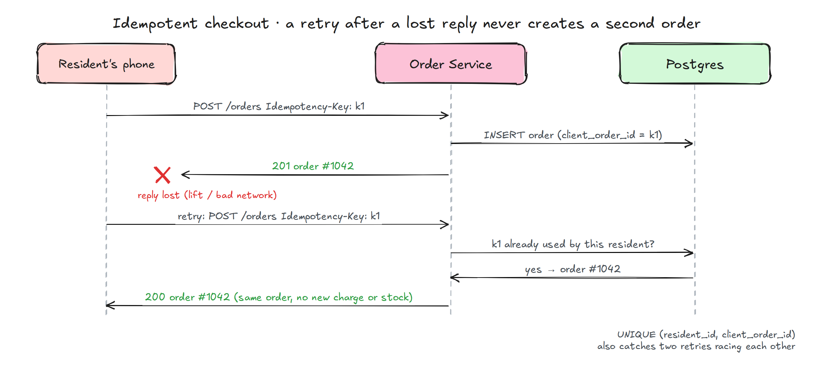
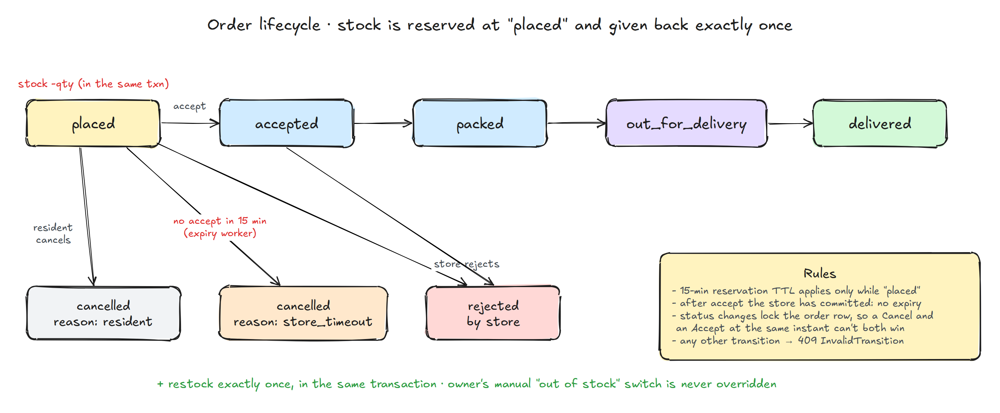

# 🧺 GateBasket

> **Quick commerce from the store inside your gate.** Residents order from their gated community's own general store, and the store's helper, who is already inside the gate, delivers to the flat in minutes.


> [!NOTE]
> The architecture, REST API and Python service code below describe the **production design**. The working MVP in this repo implements the same rules with **Supabase (Postgres functions) + Expo** for speed of delivery. See [Implementation note](#-implementation-note) for how each piece maps.

## 📑 Table of Contents

- [The problem](#-the-problem)
- [How it works](#-how-it-works)
- [Screenshots](#-screenshots)
- [Features](#-features)
- [Requirements](#-requirements)
- [System design](#️-system-design)
- [Back-of-the-envelope numbers](#-back-of-the-envelope-numbers)
- [REST API](#-rest-api)
- [Data model](#-data-model)
- [Key design decisions](#-key-design-decisions)
- [Scaling path](#-scaling-path)
- [Testing](#-testing)
- [Repository structure](#-repository-structure)
- [Getting started](#-getting-started)
- [Roadmap](#-roadmap)
- [Implementation note](#-implementation-note)

## 💡 The problem

Most gated communities in India have a general store on site. It's a five-minute walk away, so residents end up ordering from Zepto, Blinkit or Instamart instead. Those apps have to bring a rider through the gate, and the money leaves the community.

**GateBasket turns the community store into a quick-commerce app.** It sits inside a MyGate-style community app, and delivery is done by the store's own helper:

| | Quick-commerce apps | GateBasket |
|---|---|---|
| Rider | External, needs gate entry | Store helper, already inside |
| Distance | Dark store 2–3 km away | Same compound |
| Catalog | Generic | The store residents already trust |
| Revenue | Leaves the community | Store + platform commission |

## 🔁 How it works

<p align="center">
  
</p>

## 📱 Screenshots

> 📸 *Screenshots coming soon.*

<!--
Drop images into docs/screenshots/ and uncomment:
<p align="center">
  
  
  
  
</p>
<p align="center">
  
  
</p>
-->

## ✨ Features

**Residents**
- Phone OTP login, then join a society with a code and pick block and flat
- MyGate-style UI: gradient header, Activity · Store · Apartment tabs, activity-feed order cards
- Browse by category, search, add to cart with quantity steppers. Sold-out items grey out **live**
- Checkout with a delivery note, cash/UPI on delivery
- Live order tracking (placed → accepted → packed → out for delivery → delivered), cancel before acceptance, one-tap reorder

**Store owner**
- Live order queue with a loud alert and vibration on every new order
- One-tap actions: accept, packed, out for delivery, delivered, reject, mark paid
- Today's orders and sales
- Catalog management with photos and a one-tap in/out-of-stock switch
- Store settings: open/closed, hours, minimum order, delivery fee

## 📋 Requirements

**Functional**
- Residents see only their own society's store and their own orders
- Place an order, track it live, cancel until the store accepts
- Store owners receive orders instantly and move them through a fixed lifecycle
- Owners manage catalog, prices and stock

**Non-functional**
- **Never oversell.** A store often has 1 packet left. Stock correctness beats availability (CP over AP)
- **Exactly-once orders.** Flaky lift/basement networks mean retries, and a retry must never double-order
- **Low-latency catalog.** Catalog reads are ~20× more frequent than orders, so they should be cache-served
- **Stock never stuck.** Stock held by an order the store ignores must come back automatically
- **Tenant isolation** between societies, enforced at the data layer, not only in the app

## 🏗️ System design

<p align="center">
  
</p>

| Component | Responsibility |
|---|---|
| **Expo apps** | One React Native codebase, resident and store-owner roles |
| **CDN + S3** | Product photos, served from the edge |
| **API Gateway** | JWT verification (phone OTP), per-user rate limiting, society scoping, routing |
| **Catalog Service** | Read-heavy catalog; cache-aside in Redis, invalidated on stock change |
| **Order Service** | `POST /orders`: one Postgres transaction with row locks; owns the order state machine |
| **Store Service** | Owner operations: status changes, catalog edits, store settings |
| **Postgres** | **Single source of truth** for stock and orders; constraints as the last line of defence |
| **Outbox → Queue** | Order events written in the same transaction, then published (no lost or phantom events) |
| **Realtime Gateway** | WebSocket fan-out of order-status and stock events to subscribed apps |
| **Notification worker** | Expo Push / FCM to the store owner (new order) and resident (status change) |
| **Expiry worker** | Every minute: cancel orders not accepted within 15 min, and restock |

## 🧮 Back-of-the-envelope numbers

| Assumption | Value |
|---|---|
| Societies | 10,000 |
| Flats per society | ~1,000 |
| Daily ordering rate | 20% of flats |
| **Orders / day** | **~2M** → ~23/s average, **~120/s peak** (5× evening spike) |
| Catalog reads per order | ~20 → **~2,400 reads/s peak**, mostly cache hits |
| Hot-row contention | Per store only. Locks never cross societies |

The key observation: **contention is naturally partitioned by store.** Two residents fighting for the last paneer are always in the same society, so locking a product row never blocks anyone else. That makes a plain relational row lock cheap, and later lets the system shard by `store_id`.

## 🔌 REST API

All endpoints are versioned under `/v1`, authenticated with a bearer JWT, and scoped to the caller's society by the gateway.

**Auth & onboarding**

| Method | Endpoint | Description |
|---|---|---|
| `POST` | `/v1/auth/otp` | Send OTP to a phone number |
| `POST` | `/v1/auth/verify` | Verify OTP → access + refresh tokens |
| `GET` | `/v1/societies/{join_code}` | Look up a society and its flats |
| `POST` | `/v1/me/society` | Join a society: `{ flat_id, name }` |

**Resident**

| Method | Endpoint | Description |
|---|---|---|
| `GET` | `/v1/stores/{id}/catalog?category=&q=` | Catalog (cached, 30 s TTL + invalidation) |
| `POST` | `/v1/orders` | Place an order. **Requires `Idempotency-Key`** |
| `GET` | `/v1/orders?status=active` | My orders |
| `GET` | `/v1/orders/{id}` | Order detail with items and timeline |
| `POST` | `/v1/orders/{id}/cancel` | Cancel while still `placed` |

**Store owner**

| Method | Endpoint | Description |
|---|---|---|
| `GET` | `/v1/store/orders?status=placed` | Live queue |
| `POST` | `/v1/store/orders/{id}/status` | `{ status }`, validated against the state machine |
| `POST` | `/v1/store/orders/{id}/paid` | Mark cash/UPI received |
| `POST` | `/v1/store/products` | Add a product |
| `PATCH` | `/v1/store/products/{id}` | Edit price, stock, in-stock switch |
| `PATCH` | `/v1/store` | Open/close, hours, minimum order, delivery fee |

**Realtime**: `WS /v1/ws?topics=order:{id},store:{id}:catalog,store:{id}:orders`

### Example: place an order

```http
POST /v1/orders
Authorization: Bearer <jwt>
Idempotency-Key: 3f0c9a4e-1b7d-4c39-9a51-6d2f3b8e0c11
Content-Type: application/json

{
  "items": [
    { "product_id": "b6b1…", "qty": 1 },
    { "product_id": "0c4e…", "qty": 2 }
  ],
  "payment_mode": "upi",
  "note": "Leave at the door"
}
```

The client sends **only ids and quantities**. Prices, fees and totals are computed on the server.

| Response | When |
|---|---|
| `201 Created` + order | New order placed |
| `200 OK` + same order | Retry with an `Idempotency-Key` already used |
| `409 out_of_stock` `{ product_id, available }` | Someone got the last unit first |
| `409 store_closed` | Store is closed |
| `422 below_min_order` | Subtotal under the store's minimum |
| `403` | Product belongs to another society's store |

## 🗄️ Data model

```sql
products (
  id uuid pk, store_id fk, category_id fk,
  name, price numeric, mrp numeric, unit, image_url,
  stock_qty int null CHECK (stock_qty >= 0),   -- null = not counted
  in_stock bool                                -- owner's manual switch only
)

orders (
  id uuid pk, order_no serial, store_id fk, resident_id fk, flat_id fk,
  status order_status,          -- placed | accepted | packed | out_for_delivery | delivered | cancelled | rejected
  cancel_reason text,           -- resident | store_timeout
  client_order_id uuid,         -- idempotency key
  subtotal, delivery_fee, total, payment_mode, paid,
  created_at, accepted_at, …, closed_at,
  UNIQUE (resident_id, client_order_id)
)

order_items (
  order_id fk, product_id fk, qty int,
  name_snapshot text, price_snapshot numeric   -- frozen at order time
)

outbox (id bigserial, topic text, payload jsonb, created_at, published_at null)
```

Indexes: `orders (store_id, status, created_at)` for the live queue and the expiry scan, `orders (resident_id, created_at desc)` for history, `products (store_id, category_id)` for the catalog.

## 🧠 Key design decisions

The full write-up with every edge case is in [`docs/design-decisions.md`](docs/design-decisions.md). Highlights:

### 1. Consistency over availability for stock

Stock and orders live in **one Postgres primary**. Phones never decide whether an order succeeded, and **the cart reserves nothing**: it lives on the phone, so abandoned carts never hold stock. If the network is down, checkout fails instead of queueing offline. A clear "no" beats overselling the last packet. The only eventually consistent part is the live UI, and checkout always re-checks under a lock.

### 2. One transaction + row locks: the last packet goes to exactly one person

<p align="center">
  
</p>

```python
# order_service/routes/orders.py  (production design sketch)
@router.post("/v1/orders", status_code=201)
async def place_order(
    body: PlaceOrderIn,
    idempotency_key: UUID = Header(..., alias="Idempotency-Key"),
    user: Resident = Depends(current_resident),
    db: Connection = Depends(get_db),
):
    if order := await find_by_key(db, user.id, idempotency_key):
        return JSONResponse(await serialize(db, order), status_code=200)   # replay

    try:
        async with db.transaction():
            store = await get_open_store(db, user.society_id)              # 409 store_closed
            qty_by_product = merge_lines(body.items)                       # dedupe cart lines

            lines, subtotal = [], Decimal(0)
            # Lock rows in a fixed (id) order, so overlapping carts queue instead of deadlocking.
            for product_id in sorted(qty_by_product):
                qty = qty_by_product[product_id]
                p = await db.fetchrow(
                    "SELECT * FROM products WHERE id = $1 AND store_id = $2 FOR UPDATE",
                    product_id, store.id,
                )
                if p is None:
                    raise Forbidden()
                if not p["in_stock"] or (p["stock_qty"] is not None and p["stock_qty"] < qty):
                    raise OutOfStock(p["id"], p["name"], available=p["stock_qty"] or 0)   # → 409
                if p["stock_qty"] is not None:
                    await db.execute("UPDATE products SET stock_qty = stock_qty - $1 WHERE id = $2", qty, p["id"])
                lines.append((p["id"], p["name"], p["price"], qty))          # price snapshot
                subtotal += p["price"] * qty

            if subtotal < store.min_order:
                raise BelowMinOrder(store.min_order)                         # → 422

            order_id = await insert_order(db, user, store, subtotal, body, idempotency_key)
            await insert_items(db, order_id, lines)
            await outbox(db, "order.placed", order_id=order_id, store_id=store.id)
    except UniqueViolationError:
        # Two retries raced; the other one committed first. Whole txn rolled back, so no stock leaked.
        order = await find_by_key(db, user.id, idempotency_key)
        return JSONResponse(await serialize(db, order), status_code=200)

    return await serialize(db, order_id)
```

- The lock exists **only for the milliseconds of checkout**, never while browsing.
- **Locks are always taken in `product_id` order**, so carts sharing items can't deadlock.
- `CHECK (stock_qty >= 0)` is a **last line of defence** even if a code path forgets the lock.
- **Server-side prices:** each order item snapshots name and price, so later price edits never rewrite history.

### 3. Why not a Redis lock with a TTL?

Ticket-booking designs often put a Redis lock (`{ticketId: true} TTL 10m`) on a seat while the user pays. GateBasket deliberately doesn't, **yet**:

- Payment is cash/UPI **on delivery**, so there's no payment window to hold stock for. Checkout takes milliseconds.
- A DB row lock is **atomic with the stock write**. A separate Redis lock adds a second system that can disagree with Postgres (lock expired but write still in flight, Redis failover losing locks).
- When online payment arrives, the reservation becomes an **`awaiting_payment` order row with an expiry** in Postgres, cleaned up by the same expiry worker. That gives one source of truth instead of two.

### 4. Idempotent checkout: retries never double-order

<p align="center">
  
</p>

The phone can't tell "it failed" from "it worked but the reply was lost". The app generates a UUID **once per checkout** and sends it on every retry. `UNIQUE (resident_id, client_order_id)` makes the database the referee: a replay returns the original order, and two simultaneous retries can't both insert.

### 5. Order state machine + a reservation that expires

<p align="center">
  
</p>

```python
TRANSITIONS = {
    "placed":           {"accepted", "rejected", "cancelled"},
    "accepted":         {"packed", "rejected"},
    "packed":           {"out_for_delivery"},
    "out_for_delivery": {"delivered"},
}
RESTOCK_ON = {"rejected", "cancelled"}

async def change_status(db, order_id, new_status, actor):
    async with db.transaction():
        order = await db.fetchrow("SELECT * FROM orders WHERE id = $1 FOR UPDATE", order_id)
        authorize(order, actor)
        if new_status not in TRANSITIONS.get(order["status"], set()):
            raise InvalidTransition(order["status"], new_status)            # → 409
        await db.execute("UPDATE orders SET status = $2, … WHERE id = $1", order_id, new_status)
        if new_status in RESTOCK_ON:
            await restock(db, order_id)                                      # same txn → exactly once
        await outbox(db, f"order.{new_status}", order_id=order_id)
```

```python
# workers/expiry.py: runs every minute
async def expire_stale_orders(db, minutes: int = 15) -> int:
    async with db.transaction():
        stale = await db.fetch(
            """SELECT id FROM orders
                WHERE status = 'placed' AND created_at < now() - make_interval(mins => $1)
                ORDER BY created_at
                FOR UPDATE SKIP LOCKED      -- never fight a store that is accepting right now
                LIMIT 500""",
            minutes,
        )
        for row in stale:
            await db.execute(
                "UPDATE orders SET status = 'cancelled', cancel_reason = 'store_timeout', closed_at = now() WHERE id = $1",
                row["id"],
            )
            await restock(db, row["id"])
            await outbox(db, "order.cancelled", order_id=row["id"], reason="store_timeout")
    return len(stale)
```

- The order row locks on every transition, so a resident's **Cancel** and the store's **Accept** at the same instant can't both win.
- Placing an order reserves stock. If the store doesn't accept within **15 minutes**, the reservation expires and the stock comes back. Once accepted, the store has committed, so there's no expiry.
- **Restock happens exactly once** (an order can be closed only once), in the same transaction, and it **never flips the owner's manual "out of stock" switch** back on (e.g. the packet went bad).

### 6. Transactional outbox for events

Notifications and live updates are written to an `outbox` table **in the same transaction** as the order change, then published to the queue. That avoids the dual-write problem: no push for an order that rolled back, and no committed order without its event.

### 7. Cache the catalog, never trust the cache at checkout

- Catalog: **cache-aside in Redis** (30 s TTL), invalidated by stock-change events, so pull-to-refresh and live greying-out stay fresh.
- Realtime events are **hints to re-fetch**, not data. The UI never applies a payload as truth.
- Checkout ignores every cache and re-reads stock under the row lock.

### 8. Tenant isolation at the data layer

Every query is scoped by the caller's society, and Postgres **row-level security** enforces it again underneath. A bug in one service can't leak another society's store or a neighbour's orders.

## 📈 Scaling path

| Stage | Change |
|---|---|
| 1 → 1k societies | Single Postgres primary + read replica for catalog; Redis cache |
| 1k → 10k | Partition `orders` by month; move the expiry scan to a partial index `WHERE status = 'placed'` |
| 10k+ | **Shard by `store_id`**: every transaction touches one store, so there are no cross-shard writes |
| Online payment | `awaiting_payment` status with a short expiry, same worker; Razorpay webhooks via the outbox |
| Reliability | Outbox publisher with retries + DLQ; idempotent consumers keyed on event id |

## 🧪 Testing

```bash
npm run test:db     # migrations + seed + RLS and order rules on in-memory Postgres (PGlite)
npx tsc --noEmit
npx expo lint
```

The database suite covers society isolation, role protection, price snapshots and totals, out-of-stock / over-stock / minimum-order rejection, closed store, the state machine, cancel and restock, **idempotent retries**, **selling the last unit**, the manual out-of-stock switch, the **15-minute auto-cancel**, and Realtime publication.

## 📂 Repository structure

```text
gatebasket/
├── src/
│   ├── app/                    # Expo Router screens
│   │   ├── (resident)/         # Activity · Store · Apartment tabs
│   │   ├── (store)/            # Orders · Catalog · Settings tabs (store owner)
│   │   └── cart.tsx, order/[id].tsx, product-edit.tsx, login.tsx, onboarding.tsx
│   ├── components/             # Shared UI (cards, pills, steppers, header tabs)
│   └── lib/                    # Supabase client, auth, cart store, queries, theme
├── supabase/
│   ├── migrations/             # Schema, RLS, order functions, expiry job
│   ├── functions/notify-order/ # Push notification edge function
│   ├── tests/                  # Database tests (PGlite, no Docker needed)
│   ├── seed.sql                # Demo society (code GREEN1), 48 flats, store, 30 products
│   └── seed-images/            # Product photos from Wikimedia Commons (see CREDITS.md)
└── docs/
    ├── design-decisions.md     # Full consistency write-up
    ├── images/                 # README diagrams
    └── screenshots/
```

## 🚀 Getting started

### 1. Requirements
- Node **22+** (`nvm use` reads `.nvmrc`)
- A free [Supabase](https://supabase.com) project

### 2. Database
In the Supabase dashboard **SQL Editor**, run each file in `supabase/migrations/` in order (`0001_init.sql`, then `0002_order_safety.sql`), and then `supabase/seed.sql`.

Or, with the CLI:
```bash
npx supabase link --project-ref <your-project-ref>
npx supabase db push
psql "<your-db-connection-string>" -f supabase/seed.sql
```

### 3. Phone login
Go to **Authentication → Providers → Phone**, turn it on, and connect an SMS provider (Twilio, MessageBird, Vonage or Textlocal).
For development, skip SMS by adding **test phone numbers** with fixed OTPs on the same page, for example `919000000001 → 123456`.

### 4. App
```bash
npm install
cp .env.example .env   # fill in your project URL and anon key
npx expo start
```
Open it in Expo Go, or in a development build for push notifications (see below).

### 5. Make a store owner
Sign in once in the app with the store owner's phone number, then run this in the SQL editor:
```sql
select assign_store_owner('+919000000002', '00000000-0000-0000-0000-0000000000a1');
```
Restart the app. That user now sees the store dashboard.

### 6. Push notifications (optional)
1. `npx eas-cli@latest init` adds an EAS project id. Push needs a [development build](https://docs.expo.dev/develop/development-builds/introduction/), because Expo Go on Android doesn't support push.
2. Deploy the function and set a secret:
   ```bash
   npx supabase functions deploy notify-order --no-verify-jwt
   npx supabase secrets set WEBHOOK_SECRET=<random-string>
   ```
3. In **Database → Webhooks**, create a webhook on table `orders` for events **Insert** and **Update**. Point it at the `notify-order` Supabase Edge Function, with the HTTP header `x-webhook-secret: <random-string>`.

## 🗺️ Roadmap
- "Not delivered" step that closes the order and restocks it
- "Remove unavailable items and place the rest" at checkout
- Back-in-stock notifications
- Online UPI payments (Razorpay) with an expiring `awaiting_payment` reservation, and platform commission
- More than one store per society
- Visitor pre-approval and guard app
- Bulk catalog import from CSV or barcodes

## 📝 Implementation note

The sections above are the **target production architecture**. To ship a working MVP quickly, this repo implements **the same rules** on **Supabase + Expo**. The consistency logic is identical; it runs as Postgres functions instead of Python services:

| Production design | In this repo |
|---|---|
| FastAPI Order Service (`POST /v1/orders`) | `place_order` Postgres function (security definer): same transaction, `FOR UPDATE` in id order, idempotency key |
| Store Service status endpoint | `update_order_status`, `cancel_order`, `set_order_paid` functions |
| API Gateway JWT + society scoping | Supabase Auth (phone OTP) + row-level security + column grants |
| Expiry worker (cron) | `expire_stale_orders` scheduled with `pg_cron` every minute |
| Outbox → queue → notification worker | Database webhook → `notify-order` Edge Function → Expo Push |
| Realtime Gateway (WebSocket) | Supabase Realtime on `orders` and `products` |
| Redis catalog cache | React Query cache (30 s stale time) + Realtime invalidation |
| S3 + CDN | Supabase Storage |

The Python snippets above are design sketches, not code in this repo. The behaviour they describe is implemented in [`supabase/migrations/`](supabase/migrations/) and verified by `npm run test:db`.
